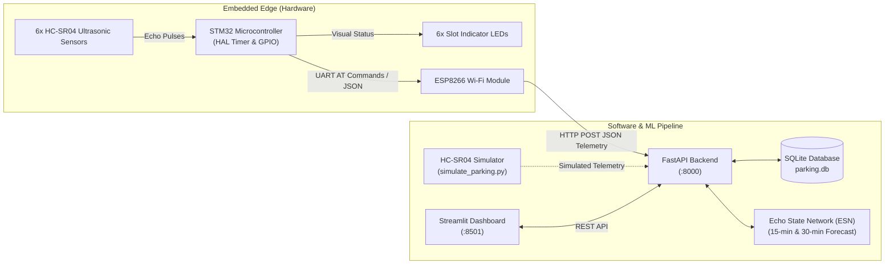

# Smart Parking Occupancy Predictor

A complete IoT and Machine Learning system for parking slot occupancy detection and forecasting. Designed for an **STM32 microcontroller**, **6x HC-SR04 ultrasonic sensors**, an **ESP8266 Wi-Fi module**, and an **Echo State Network (ESN)** running in Python to predict vacant parking spots 15 and 30 minutes in advance.

---

## 🏗️ Architecture Overview



---

## 📁 Project Directory Structure

```text
smart_parking_predictor/
├── backend/
│   ├── __init__.py
│   ├── database.py             # SQLite configuration and SQLAlchemy ORM models
│   ├── schemas.py              # Pydantic schemas for telemetry validation
│   └── main.py                 # FastAPI REST API (telemetry ingestion, status, forecast)
├── ml/
│   ├── __init__.py
│   ├── esn.py                  # Custom Echo State Network with Leaky Neurons & Ridge Readout
│   ├── train_esn.py            # Synthetic parking dynamics generator & ESN training script
│   └── esn_model.npz           # Serialized weights of the trained ESN model
├── frontend/
│   └── dashboard.py            # Streamlit real-time 6-bay dashboard with LED visualization
├── simulator/
│   └── simulate_parking.py     # HC-SR04 ultrasonic sensor physical simulator
├── firmware/
│   ├── Inc/
│   │   ├── parking_config.h    # Config and pin mapping template (Rule 9 compliant)
│   │   ├── hcsr04.h            # Ultrasonic driver header (microsecond timer capture)
│   │   ├── led_indicators.h    # LED indicator driver header
│   │   ├── esp8266.h           # ESP8266 AT UART driver header
│   │   └── parking_app.h       # Main application coordinator header
│   ├── Src/
│   │   ├── hcsr04.c            # Pulse generation, timeout handling, and distance math
│   │   ├── led_indicators.c    # LED state controller and power-on self-test
│   │   ├── esp8266.c           # Wi-Fi join and HTTP POST telemetry transmission
│   │   └── parking_app.c       # Main scanning loop with anti-crosstalk spacing
│   └── Integration_Guide.md    # Step-by-step CubeMX and main.c wiring instructions
├── esp8266/
│   └── esp8266_bridge.ino      # Optional Arduino sketch for ESP8266 UART-to-HTTP bridge
├── tests/
│   ├── test_esn.py             # Unit tests for reservoir dynamics and prediction bounds
│   └── test_api.py             # Integration tests for FastAPI endpoints
├── parking.db                  # Local SQLite database (auto-generated)
├── pytest.ini                  # Pytest configuration
├── requirements.txt            # Python dependencies
├── run_system.py               # Convenience launcher for Windows
└── README.md                   # Complete documentation and hardware guide
```

---

## ⚡ Quickstart on Windows (PowerShell)

### 1. Prerequisites
Ensure you have **Python 3.10+** installed on your Windows machine.

### 2. Navigate to Project Directory
```powershell
cd C:\Users\stuti\Documents\SmartParkingESN
```

### 3. Install Python Dependencies
```powershell
python -m pip install -r requirements.txt
```

### 4. Run Automated Tests
Verify both the ML engine and API endpoints with pytest:
```powershell
python -m pytest tests -v
```
*(All 9 unit and integration tests should pass.)*

---

## 🚀 Running the System

You can run each component in separate PowerShell terminal windows or use the launcher.

### Option A: Using the Launcher (`run_system.py`)

#### Terminal 1: Start Backend + Dashboard Concurrently
```powershell
python run_system.py --all
```
- **FastAPI Documentation**: Open [http://127.0.0.1:8000/docs](http://127.0.0.1:8000/docs) in your browser.
- **Streamlit Dashboard**: Open [http://localhost:8501](http://localhost:8501) in your browser.

#### Terminal 2: Start Simulated Ultrasonic Sensor Feed
```powershell
python run_system.py --simulate
```
The simulator will continuously send readings every 3 seconds to the backend, showing vehicles parking and departing in real time.

---

### Option B: Running Individual Components Manually

#### Step 1: Start FastAPI Backend
```powershell
python -m uvicorn backend.main:app --host 127.0.0.1 --port 8000 --reload
```

#### Step 2: Seed Initial Historical Data (Optional)
Pre-populate the database with 40 historical parking snapshots:
```powershell
python simulator\simulate_parking.py --mode seed
```

#### Step 3: Start Streamlit Dashboard
```powershell
python -m streamlit run frontend\dashboard.py
```

#### Step 4: Run Continuous HC-SR04 Sensor Simulation
```powershell
python simulator\simulate_parking.py --mode live --interval 3.0
```

---

## 🧠 Echo State Network (ESN) Formulation

The ESN is a recurrent reservoir computing network that avoids gradient vanishing/exploding issues. It is the **only** machine learning forecasting model used in this system.

1. **Input Vector** at timestep $t$:
   $$u(t) = \left[ \frac{\text{free\_slots}}{6.0},\, \sin\left(\frac{2\pi \cdot \text{hour}}{24}\right),\, \cos\left(\frac{2\pi \cdot \text{hour}}{24}\right) \right]^T$$

2. **Leaky Reservoir Dynamics**:
   $$x(t) = (1 - \alpha)\,x(t-1) + \alpha\,\tanh\left(W_{\text{in}} u(t) + W_{\text{res}} x(t-1) + W_{\text{bias}}\right)$$
   - Reservoir size: $N_x = 100$ neurons
   - Leak rate: $\alpha = 0.40$
   - Sparsity: $85\%$ zero connections
   - Echo State Property: $W_{\text{res}}$ is scaled so its spectral radius $\rho(W_{\text{res}}) = 0.85 < 1.0$.

3. **Multi-Step Ridge Readout**:
   $$W_{\text{out}} = Y_{\text{target}} S^T \left(S S^T + \lambda I\right)^{-1}$$
   - State matrix: $S = [1;\, u(t);\, x(t)]$
   - Regularization: $\lambda = 1.0$
   - Dual targets: $y_{t+15\text{min}}$ (3 steps ahead) and $y_{t+30\text{min}}$ (6 steps ahead).

---

## 🔌 Hardware Roadmap: STM32F103C8T6 ("Blue Pill")

### Target Microcontroller Specifications
- **Core:** ARM Cortex-M3 @ up to 72 MHz
- **Flash Memory:** 64 KB
- **SRAM:** 20 KB
- **General-Purpose Timers:** 16-bit hardware counters (TIM2, TIM3, TIM4)

### Memory & Firmware Optimizations
1. **Flash Overhead Optimization:**
   - Standard ARM `newlib-nano` requires `-u _printf_float` to print floating-point numbers (`%.1f`), which costs ~10 to 12 KB of Flash memory.
   - The driver in `firmware/Src/esp8266.c` formats distances using integer arithmetic (whole and tenths components: `%d.%d`), completely avoiding floating-point printf and saving ~12 KB of Flash.
2. **SRAM Buffer Optimization:**
   - Static buffers in `esp8266.c` have been reduced from 2,048 bytes to 1,088 bytes, freeing nearly 1 KB of RAM for stack and ISR execution.
3. **16-Bit Timer Rollover Handling:**
   - General-purpose timers on the STM32F103 are 16-bit (`0` to `65535`).
   - Counter calculations in `firmware/Src/hcsr04.c` use explicit 16-bit modulo arithmetic `(uint16_t)(cnt - start)`, preventing false timeouts when the timer rolls over.

### Flashing and Debugging Notice (SWD Interface)
> [!IMPORTANT]
> The onboard micro-USB connector on generic Blue Pill boards is wired to PA11/PA12 for USB communication and power; it does **not** provide an onboard ST-LINK programmer.
> 
> Flashing must be performed via the **4-pin SWD header** at the end of the board:
> - **3.3V** ➡️ 3.3V on ST-Link V2
> - **SWDIO** (PA13) ➡️ SWDIO on ST-Link V2
> - **SWCLK** (PA14) ➡️ SWCLK on ST-Link V2
> - **GND** ➡️ GND on ST-Link V2
> - Ensure **BOOT0** and **BOOT1** jumpers are set to position `0`.

---

## 📋 Task Breakdown & Status

### ✅ Phase 1: Completed Autonomously
- [x] Full Python stack (FastAPI backend, SQLite schema, ESN forecaster, HC-SR04 physical simulator, Streamlit dashboard).
- [x] Automated test suite: 9/9 tests verified passing.
- [x] Modular STM32 HAL C firmware (`hcsr04`, `led_indicators`, `esp8266`, `parking_app`, `parking_config`).
- [x] Memory & Flash optimizations for STM32F103C8 (no float printf, buffer shrinkage, 16-bit timer wrap-around fix).
- [x] Windows setup and integration guides.

### ⏳ Phase 2: User Action in STM32CubeIDE (Next Step)
- [ ] Create targeted STM32Cube project (`STM32F103C8Tx`) in STM32CubeIDE to generate the `.ioc` and download the ST HAL F1 driver package.
- [ ] Confirm chosen pin assignments for the 6 TRIG pins, 6 ECHO pins, 6 LED pins, Timer, and UART1.

### 🔬 Phase 3: Hardware Integration & Physical Board Testing
- [ ] Flash compiled firmware via ST-Link V2.
- [ ] Physical ultrasonic sensor distance calibration and live testing with actual hardware.
